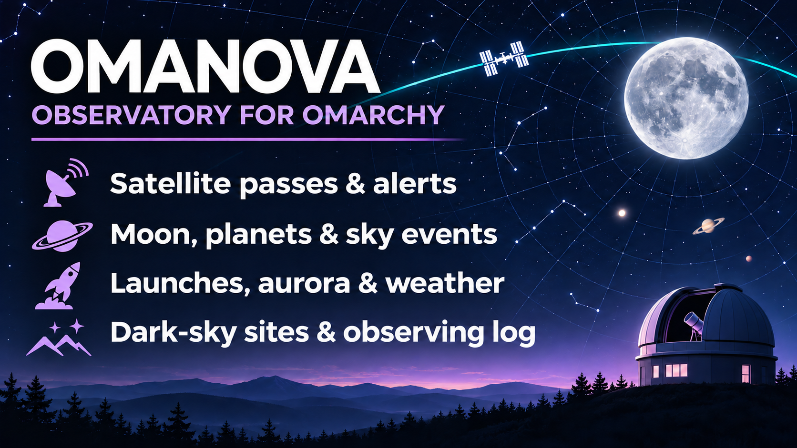

# OMANOVA



OMANOVA is a local astronomy Observatory and bar widget for Omarchy Quattro.
Left-click the widget to open the resizable Observatory. Middle-click for the
compact fallback. Set your observing location manually under **Settings**.

## Features and options

| Area | What it offers |
| --- | --- |
| Overview, Sky View and Conditions | ISS and Tiangong countdown, pass compass and scrubber, viewing direction and elevation, forecast and source age. |
| Events | Local station opportunities, all predicted passes, and a separate launch schedule with timing precision and webcast links when supplied. |
| Orbit | ISS and Tiangong ground tracks, observer position, pass scrubber, bearing, elevation and range. |
| Moon | Phase graphic, illumination, rise and set, named next full Moon, supermoon or micromoon class and local darker-sky windows. |
| Meteor Showers | Peaks, local viewing times, radiant direction and Moon interference. |
| Planets & Conjunctions | Naked-eye planet highlights, local times and directions, and close pairings. |
| Comets | Dated catalogue, local windows and finder coordinates, with rough equipment guidance. |
| Eclipses | Solar and lunar eclipses through 2029, local windows and solar-viewing safety links. |
| Launch Plumes | Twilight geometry when a sourced timed trajectory exists. Otherwise visibility is unconfirmed. |
| Watchlist and Starlink Trains | Potential sunlit passes for bright satellites and recently tracked Starlink groups. Missing train data leaves visibility unconfirmed. |
| Aurora | NOAA-based model sightlines and a separate global Kp outlook. Missing or stale data is uncertain. |
| Dark-Sky Sites | Regional sample catalogue for Middle Tennessee and nearby states, with driving estimates, access and darkness evidence. |
| Observing Log | Local entries with what you saw, place, time and notes. |
| Settings and alerts | Saved and temporary locations, orbital and weather download controls, manual refresh and optional station alerts with a 15-minute lead. |

## Install

Requires Omarchy Quattro with its Quickshell and Hyprland session, system
Python 3.12 or later with compatible wheels, Git, curl, uv, jq, flock, and
`notify-send` for optional desktop alerts. The setup installs the exact
Python package versions in [requirements.txt](requirements.txt) and downloads
the NASA/JPL DE440s ephemeris over HTTPS with a SHA-256 check.

From a terminal, choose a permanent directory for the checkout:

```sh
git clone --branch v0.1.1 https://github.com/shaggyrs6-netizen/omanova.git
cd omanova
./setup-runtime
omarchy plugin add https://github.com/shaggyrs6-netizen/omanova.git --enable
```

If uv is missing on Arch, install it through your package manager
(`sudo pacman -S uv`). Open the widget and set your location. Enable orbital
downloads in Settings to get live passes. Weather is a separate opt-in.
Keep this command running in a terminal to refresh data and deliver opted-in
alerts. Press Ctrl+C to stop it. Setup does not register an autostart, timer
or service.

```sh
OPENBLAS_NUM_THREADS=1 .venv/bin/python worker.py watch
```

For an offline first look, run `./preview-observatory` from the checkout.
The fixture uses public example locations.

### Upgrading an existing installation

1. Stop the foreground worker with Ctrl+C in its terminal, if it is running,
   and close the Observatory.
2. Keep the runtime checkout in place. Fetch the tags, check out the new
   release tag from a clean worktree, and rerun `./setup-runtime` there.
3. Update the installed widget with
   `omarchy plugin update io.github.shaggyrs6-netizen.omanova`.
4. If you use live updates, restart the worker manually with
   `OPENBLAS_NUM_THREADS=1 .venv/bin/python worker.py watch` from the
   runtime checkout. Then reopen the Observatory from the widget.

If upgrading from Omasky 0.1.0, point the checkout's remote at the renamed
repository before fetching. Disable the old widget with
`omarchy plugin disable io.github.shaggyrs6-netizen.omasky`, then use the
install command above to add the new widget instead of updating it.
The data directory retains its original `omasky` name so existing locations,
preferences and observing logs remain available.

## Remove

Stop the foreground worker with Ctrl+C and close the Observatory, then run:

```sh
omarchy plugin remove io.github.shaggyrs6-netizen.omanova
```

The plugin command leaves your local log and profiles in
`${XDG_DATA_HOME:-$HOME/.local/share}/omasky`. To retire the runtime too,
check that its `runtime` link points to this checkout, then unlink it and
move the checkout out of the way. Keep the data directory to retain your log.

## Data and privacy

Location, logs and caches stay local. Only opted-in Open-Meteo requests
send observer coordinates, rounded to two decimal places. Orbital requests,
launch schedules and NOAA guidance send no observer coordinates. Launch
Library 2 and NOAA downloads each require their own opt-in under Settings.
Launch downloads cover schedules and Starlink deployment lookups. Reopen
the Observatory for launch changes or reopen the Aurora tab for aurora
changes. Paused feeds may show cached data. External links open on demand. See
[Data sources and licence notes](DATA-SOURCES.md).

### Maintenance

The dated comet catalogue expires on 17 November 2026 at 00:00 UTC. Dark-sky
access and travel estimates need occasional review. Launch schedules may use
cached data if a refresh fails. Weather and astronomy are estimates and
local terrain or obstructions can change what you see.

## Preview on Omarchy

From this directory, run:

```sh
./preview
```

This opens a separate Wayland window with the actual widget and panel. Click the
bar label to open the native popout, or use the full panel already in the window.
The countdown uses a frozen 9 November 2026 clock. The preview has two named
public test locations, Nashville and Sydney. Use Settings to switch locations
or enter a temporary one. Close the window or press Ctrl+C in the terminal
to finish. The preview uses only fixture elements and local state in
`.preview/`. Its orbital and weather network controls are disabled.

## Checks

```sh
OPENBLAS_NUM_THREADS=1 .venv/bin/python -m unittest discover -s tests -v
```

The ISS test compares Nashville pass rise, culmination and set against a
one-second interpolation of NASA/JSC's independently supplied trajectory.
Tolerance is 15 seconds, 1° peak elevation and 3° bearing. The Tiangong test
compares the Sydney pass to a separate one-second scan using the same published
CelesTrak elements. Additional cases cover partial shadow, high daylight
passes, low passes, stale and expired elements, event-time weather and UTC
midnight, rounding and opt-in, temporary locations, and a throttled feed.

The Wayland smoke test exercised the fixture label, popout open/close, compass,
temporary location and restoration to a saved location. This uses an isolated
preview bar host. The widget and Observatory also ran in a live Omarchy session.

For a clean manifest validation, run `./stage-plugin .preview/plugin-check`
with a new destination. It copies only the manifest and runtime QML, then
runs Omarchy’s validator. The Python runtime stays outside the plugin folder.
The setup script links the runtime from the OMANOVA data directory.

## Runtime

The workspace-local `.venv` is prepared with the pinned dependencies in
`requirements.txt`. If rebuilding, create a virtual environment with
`uv venv --python /usr/bin/python .venv` and install with
`uv pip install --python .venv/bin/python -r requirements.txt`.
Obtain the ephemeris from
[JPL DE440s](https://ssd.jpl.nasa.gov/ftp/eph/planets/bsp/de440s.bsp) and place it
in `assets/de440s.bsp`. The tested SHA-256 is
`c1c7feeab882263fc493a9d5a5b2ddd71b54826cdf65d8d17a76126b260a49f2`.

The worker supports `refresh` for one pass and `watch` for an independent
foreground refresh loop. No service has been registered. In live mode it
uses `${XDG_DATA_HOME:-$HOME/.local/share}/omasky` by default. A worker lock
serialises refreshes and edits. Settings and snapshots are written atomically
and remain private to the local user. A temporary location lasts until
selecting or saving another place. Times display in the desktop's system zone.

Orbital downloads and weather both start off. Enabling orbital downloads
permits one CelesTrak station-group request every two hours. It sends no
observer coordinates. Non-200 responses pause the adapter. Investigate first,
then use the worker's `resume-orbits` command to resume. Enabling weather also
requires network refresh and sends the active location rounded to two decimal
places to Open-Meteo. It uses hourly data around the actual viewing interval
and marks expired or incomplete coverage uncertain. The free hosted forecast
API is for non-commercial use. The feeds require no account or API key.

Orbit geometry is provisional. The initial visibility heuristic uses a 10°
elevation floor and a Sun altitude of −6° or lower. Uncertain weather can
still appear in the bar with an explicit uncertain state. Poor conditions and
elements over 72 hours from the pass stay off the bar. Elements over seven
days from the pass are excluded. Nearby obstructions, actual cloud breaks and
recent station manoeuvres can affect the result.

## Fixture provenance

- [CelesTrak stations GP JSON](https://celestrak.org/NORAD/elements/gp.php?GROUP=stations&FORMAT=JSON),
  retrieved on 9 November 2026. Only the ISS and Tianhe records are retained
  locally in the fixture. See the [provider usage policy](https://celestrak.org/usage-policy.php).
- [NASA Spot the Station trajectory](https://www.nasa.gov/spot-the-station/),
  with five sample vectors from the 6 November 2026 NASA/JSC/FOD/TOPO OEM.
  The comparison uses the trajectory feed and does not duplicate NASA's
  published city-specific sighting filters.
- [Daylight](https://github.com/nixfred/daylight.omarchy) is the interaction
  reference. OMANOVA's QML and drawings are separate implementations.

## Observatory redesign preview

Run `./preview-observatory` for the resizable native window. It uses the same
offline orbital fixtures as the original preview, with a synthetic area
forecast for the public Nashville fixture. The countdown and forecast are
examples for design review.

Overview shows the first-look direction and viewing window. In Sky View,
drag the slider or focus it and use the arrow keys to move through the pass.
Conditions shows the forecast ranges used to assess the viewing window.
Narrow windows stack the sections vertically. The preview uses its own
workspace state and leaves the live bar and worker in place.

Run `./preview-observatory --live` to read the same local snapshot as the
live bar in a separate window. The window only reads snapshots. To refresh
them, keep the existing foreground worker running. A stale badge appears
when a live snapshot is more than three minutes old. Launch without
`--live` to return to the fixture preview.

The live OMANOVA widget opens or focuses the Observatory on left-click.
Middle-click opens the compact panel for location and feed settings, and
the same panel opens if the launcher exits with an error. From a terminal,
`omarchy-shell io.github.shaggyrs6-netizen.omanova compact` also opens the compact panel.

## Events preview

Run `./preview-events --live` and select **Events** to use the current station snapshot
and a Launch Library 2 schedule. Launch data is cached separately in the
workspace and checked on opening, at most hourly. No observer coordinates
are sent to the launch feed. Use `./preview-events --fixture` for offline
station predictions and sample launch statuses.

Local opportunities use predicted station geometry and weather; All station
passes also shows unsuitable or stale passes and explains why. Selecting a
station pass opens its track in Sky View. Rocket launches stay separate and
display local visibility as unconfirmed until trajectory data supports it.
The preview does not change the bar, its launcher, or the live worker.

Events is available in the Observatory opened by the live bar. The launch
schedule is checked when the window starts, with the same separate cache
and rate limit as the preview. Middle-click still opens the compact panel.

## Orbit preview

Run `./preview-orbit --live` for a separate map window using the saved
observer and cached CelesTrak station elements. It recomputes the track at
launch, offline. Choose ISS or Tiangong, pick a pass, then scrub from
geometric rise to set. Ground distance is an approximate surface arc to
the station footprint. Line-of-sight range is the distance to the station.
Viewing windows describe geometry and illumination. Weather remains in
Events and Conditions.

Use `./preview-orbit --fixture` for a public Nashville test point and fixed
clock. The preview state is private and stays in the ignored workspace
preview directory. Neither preview mode changes the bar or starts a worker.
The offline basemap uses [Natural Earth 1:110m land](https://www.naturalearthdata.com/downloads/110m-physical-vectors/110m-land/).

Orbit is also available in the Observatory opened from the bar. Opening
the tab recalculates tracks locally from the cached station elements.

## Notification preview

Run `./preview-notifications` to test opt-in desktop alerts against offline
ISS and Tiangong fixtures. Enable the preview checkbox, choose a scenario
and select **Simulate pass**. A favourable pass sends one desktop notification
labelled Preview. Repeat it to test deduplication, or select a poor, missing,
stale or ended scenario to test suppression. Closing the window ends the
trial. The live worker does not consume these settings or the preview ledger.

Live station alerts are opt-in under **Conditions → Station alerts**.
The foreground worker checks once per minute and can send one alert per
favourable, fresh ISS or Tiangong pass in the 15 minutes before first
look. Alerts stop with the worker. The per-pass ledger is stored locally
alongside the live snapshot.

## Moon preview

Run `./preview-moon --live` for offline Moon phase, illumination, rise and
set, and darker-sky viewing windows at the saved observing point.
`./preview-moon --fixture` uses a fixed clock and public Nashville point.
Viewing windows require the Moon to be at least 5° up and the Sun at or
below −6°. They describe geometry without weather or terrain. The preview
calculates at launch. Both the standalone preview and the Observatory
show common North American full-Moon names, including the Harvest
Moon nearest the September equinox, the following Hunter’s Moon, and the
second full Moon in a local calendar month as a monthly Blue Moon. It measures
geocentric distance at exact full phase. The nearest tenth of the distance
range between the surrounding perigee and apogee is a supermoon, and the
farthest tenth is a micromoon. See [Royal Observatory Greenwich’s naming
calendar](https://www.rmg.co.uk/stories/space-astronomy/full-moon-calendar-2026)
and [the orbit-relative distance rule](https://www.timeanddate.com/astronomy/moon/super-full-moon.html).

Moon is available in the Observatory opened from the bar. Opening the tab
recalculates the phase diagram, illumination and viewing windows locally.

## Meteor shower preview

Run `./preview-meteors --live` from Wayland for the saved observing point, or
`./preview-meteors --fixture` for the fixed Nashville example. The separate
window calculates offline and does not require the foreground worker.

The bundled selection covers six peaks from November 2026 to April 2027,
using the [2026 IMO calendar](https://www.imo.net/files/meteor-shower/cal2026.pdf)
and [2027 IMO calendar](https://www.imo.net/files/data/calendar/cal2027.pdf).
It shows published peaks separately from local dark viewing windows within
roughly a day either side. Windows require a Sun altitude of −18° or lower
and a radiant altitude of 20° or higher. Radiant coordinates are fixed at
their peak values for this short span. The Moon rows show illumination at the
highest radiant and any stretches with the Moon below the horizon. Weather,
terrain and local light pollution are outside the calculation.

## Planets and conjunctions preview

Run `./preview-planets --live` to calculate from the saved observing point,
or `./preview-planets --fixture` for the frozen Nashville example. The
standalone preview uses the existing JPL ephemeris offline. It covers the
five naked-eye planets over the next 24 hours, plus planet–planet and
Moon–planet close approaches over 30 days.

Each pairing separates Earth-centred closest approach from a local viewing
window and suggested time. Pairing limits are 5° between planets and 8°
for Moon–planet pairs. Local windows require the Sun to be at least 6° below
the horizon and each target at least 10° up. The model uses sky geometry.
Clouds, obstructions and sky brightness can change what you see.

## Comet preview

Run `./preview-comets --live` for the saved observing point or
`./preview-comets --fixture` for the frozen Nashville example. This
standalone preview contains four selected targets. Its
[JPL Horizons](https://ssd.jpl.nasa.gov/horizons/) geocentric position snapshot
runs from 9 November 00:00 UTC through 17 November 00:00 UTC, 2026.
It uses two-hour observer tables (quantities 1 and 2) and interpolates
coordinates locally. Observing windows require astronomical darkness and
at least 20° elevation. Finder coordinates are J2000.

Equipment tiers use dated visual or CCD reports from the
[Comet Observation Database](https://cobs.si/recent/) as rough dark-sky
guidance. Clouds, skyglow and the diffuse coma affect actual visibility.
The bundled data expire visibly. The preview sends no observing coordinates
and does not refresh automatically.

## Eclipse preview

Run `./preview-eclipses --live` for the saved observing point or
`./preview-eclipses --fixture` for Nashville. The separate preview searches
the local JPL ephemeris through 2029. Solar windows use local apparent
Sun/Moon disc overlap. Lunar windows use Earth's shadow contacts and the
local lunar horizon. Times assume an unobstructed horizon and are approximate.

The solar cards link to [NASA's eclipse safety guide](https://science.nasa.gov/eclipses/safety/).
The preview runs offline and does not require the foreground worker.

## Settings and compact panel preview

Run `./preview-settings` in Wayland. It opens the Observatory on Settings
using sample Nashville and Sydney profiles. Try saved or temporary locations,
the orbital-download switch, weather opt-in and a one-off refresh. Select
**Show compact panel preview** to try the same controls in the restyled panel.

The two windows share isolated fixture state under `.preview/settings`.
Download choices can be exercised there without making network requests.
The installed bar and its compact fallback remain separate.

## Twilight launch plume preview

Run `./preview-plumes --live` to check the next ten Launch Library 2 entries.
The window has a separate simulated example. Run `--fixture` for an entirely
offline demonstration. The launch feed receives no observer coordinates.

The preview requires a fresh schedule, a go-for-launch status and a minute-
or second-level planned liftoff. For a real viewing window, a reviewed
`observatory/plumes/verified-tracks.json` entry must match the launch UUID and
exact schedule timestamp. Each entry has `net` (normalised UTC timestamp),
`source` (HTTPS link to the mission-specific trajectory evidence) and
`points` (ordered arrays of elapsed seconds, WGS84 latitude and longitude in
degrees, and altitude in kilometres). Include only points where exhaust is
being produced. A pad location, generic flight profile or exclusion polygon
does not establish a timed plume track.

Samples must be sunlit, at least 5° above the observer's horizon and
against a sky with the Sun at or below −6°. Runs need two consecutive
qualifying samples no more than 20 seconds apart. The output describes the
sampled geometry at the planned liftoff, with no prediction of plume
brightness or persistence. Missing, stale or mismatched evidence leaves
visibility unconfirmed. No real trajectories are bundled.

## Bright satellite watchlist preview

Run `./preview-satellites --live` for the saved observing point or
`--fixture` for the frozen Nashville example. The seven-object watchlist
uses CelesTrak's visual catalogue and a separate preview cache. It honours
the existing orbital-download setting and sends no observing coordinates.

Filter by satellite or see all upcoming windows. A window needs sunlight
on the satellite, a local Sun altitude at or below −6°, and a satellite
elevation of at least 10°. Forecasts span up to three days and exclude
windows ending more than 72 hours from the orbital epoch. The list gives
geometry, with no model for apparent magnitude, local obstructions or weather.

## Starlink trains preview

Run `./preview-trains --live` for the saved observing point or `--fixture`
for the simulated Nashville example. The separate preview honours orbital
download consent. Recent successful Starlink launches come from Launch
Library 2, with tentative launches read from the existing cached schedule.
CelesTrak's mission-specific supplemental data associates a group number
with an international launch designator. Predictions use separately
catalogued Starlink member elements for that designator. Deployment-stack
or single-satellite placeholders alone cannot establish a train.

The experimental screen checks launches up to 14 days old and the next 24
hours of viewing geometry. It uses orbital epochs within 36 hours of each
sample. A candidate needs at least three simultaneously sunlit members at
least 15° up in a six-degree radius around one member, with the local Sun
at or below −6°. It requires consecutive ten-second samples. This screens
for compact geometry and does not estimate apparent magnitude or guarantee
that the group appears as a line. Missing data leaves visibility unconfirmed.
Calculations are local and the sources receive no observing coordinates.

## Aurora preview

Run `./preview-aurora --live` for the saved observing point or `--fixture`
for the simulated storm. The separate window uses NOAA SWPC's public
OVATION grid and planetary Kp forecast. The source receives no observing
coordinates. **Refresh forecast** checks the feeds on demand.

The local screen tests model cells at an assumed 110 km emission altitude,
requiring multiple cells at least 3° above an unobstructed horizon and a
local Sun at or below −12°. Its suggested direction is a model sightline,
with no local probability or cloud prediction. Old or missing model runs
are marked uncertain. The next three dark periods show the strongest
overlapping global Kp block, as context for when to recheck OVATION.

## Dark-sky sites preview

Run `./preview-dark-sites` in Wayland. It opens a standalone list of five
observing destinations near Mount Juliet, sorted by estimated road distance.
The drop-in filter hides sites that require a programme or booking. Links
open the public destination pin, access information and darkness evidence.

The bundled catalogue was checked on 9 November 2026. Road mileage and
driving times come from OSRM/OpenStreetMap, using the public town centre as
origin and no live traffic. Ratings distinguish site measurements, park-wide
classifications and sites without a verified numerical rating. The preview
reads its catalogue offline and does not use the saved observing address.

## Observing log preview

Run `./preview-observing-log` in Wayland. Enter what you saw, where you
were, the local date and time, and optional notes. The form starts with
the current desktop time. Saved entries are sorted by observation time
and preserve the UTC offset that applied when entered.

The preview keeps entries in a private, persistent file under
`.preview/observing-log/data/`. It makes no network requests and does not
read the live observing location or write to the live Observatory.
