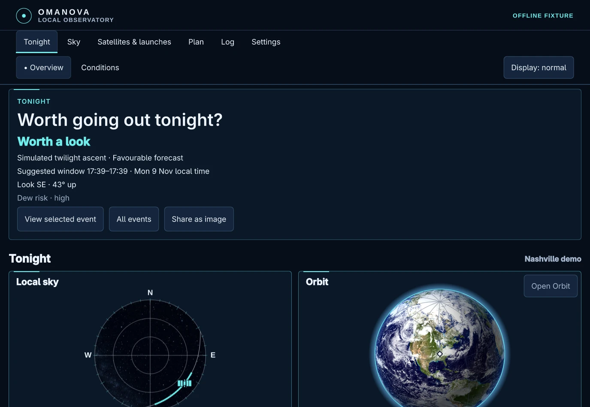
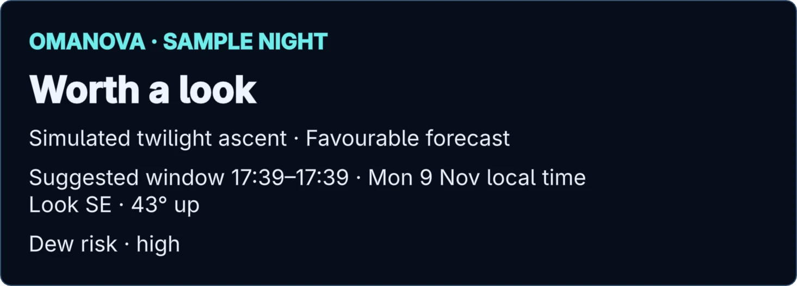
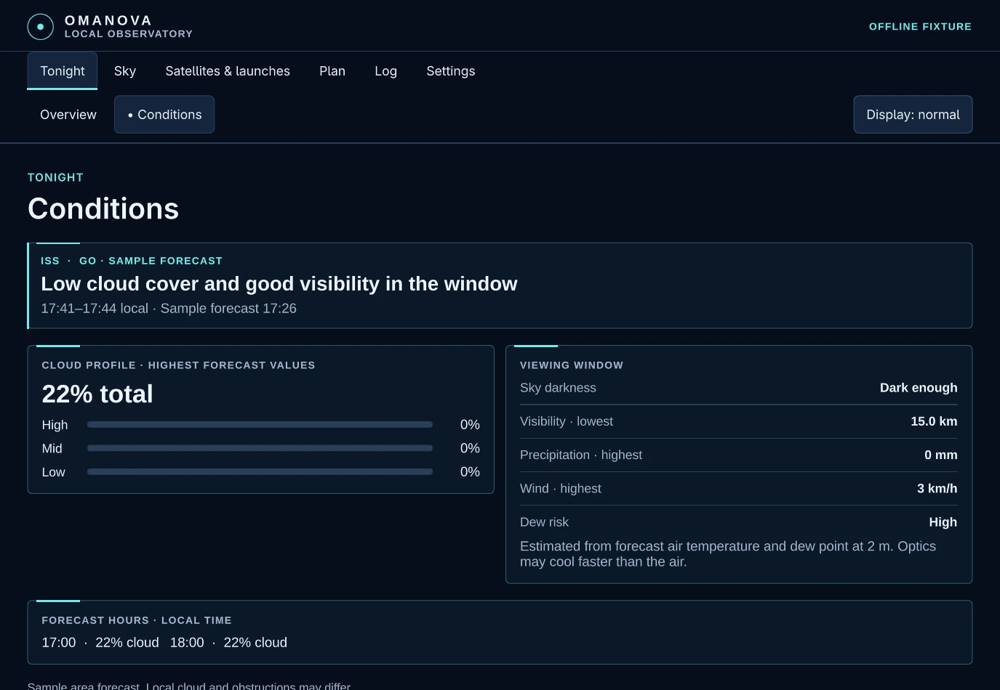
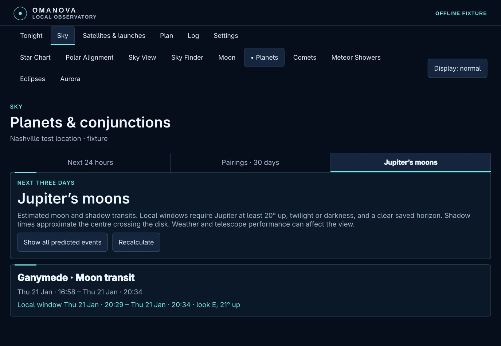
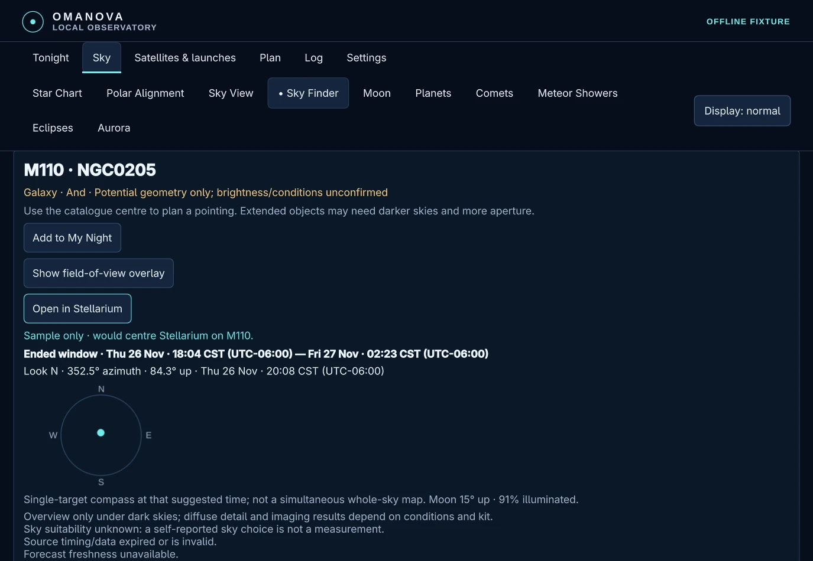
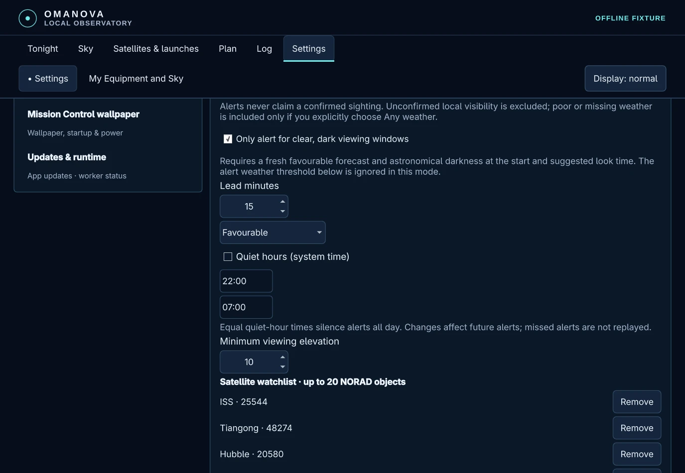
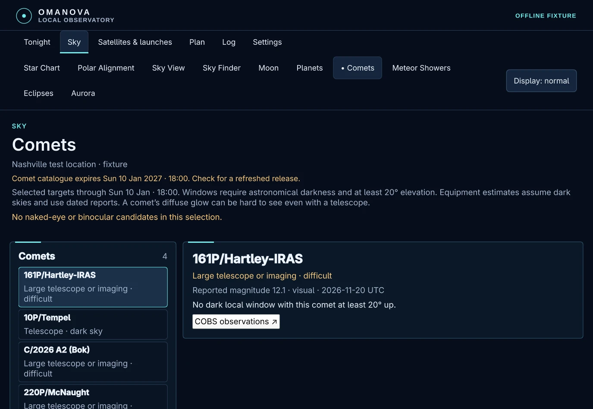

# OMANOVA 0.1.11 screenshots

These captures use a public Nashville sample location and synthetic weather. The Jupiter and expiry views use sample dates.

## Tonight and the saved card

## Conditions

## Jupiter’s moons

## Sky Finder and Stellarium

## Observing alerts

## Comets

