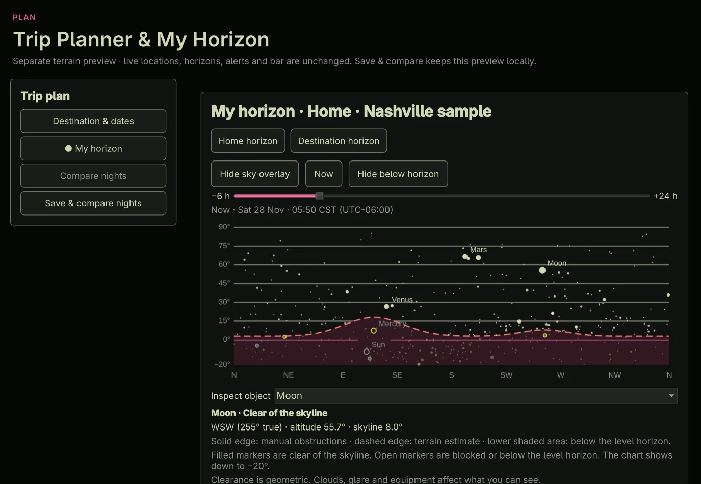
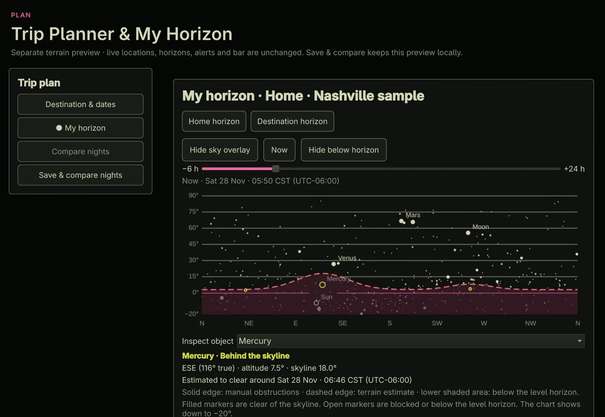
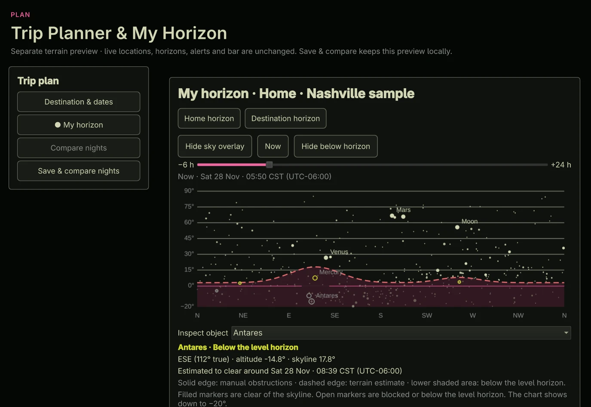
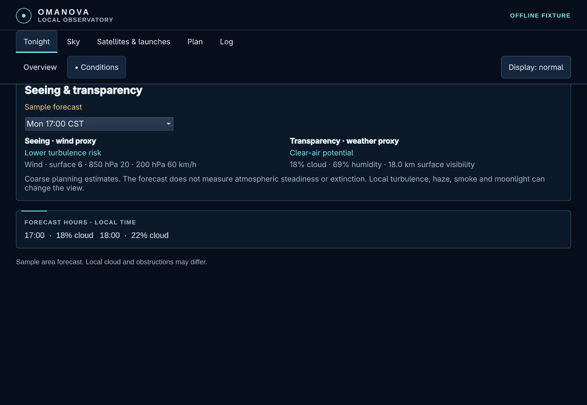
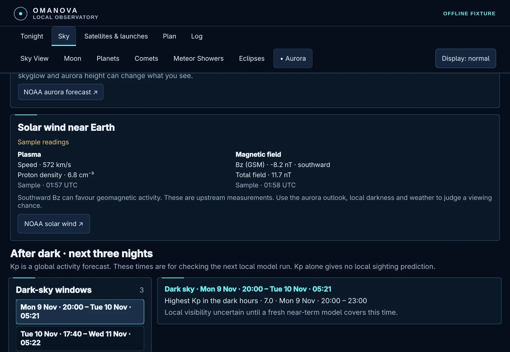
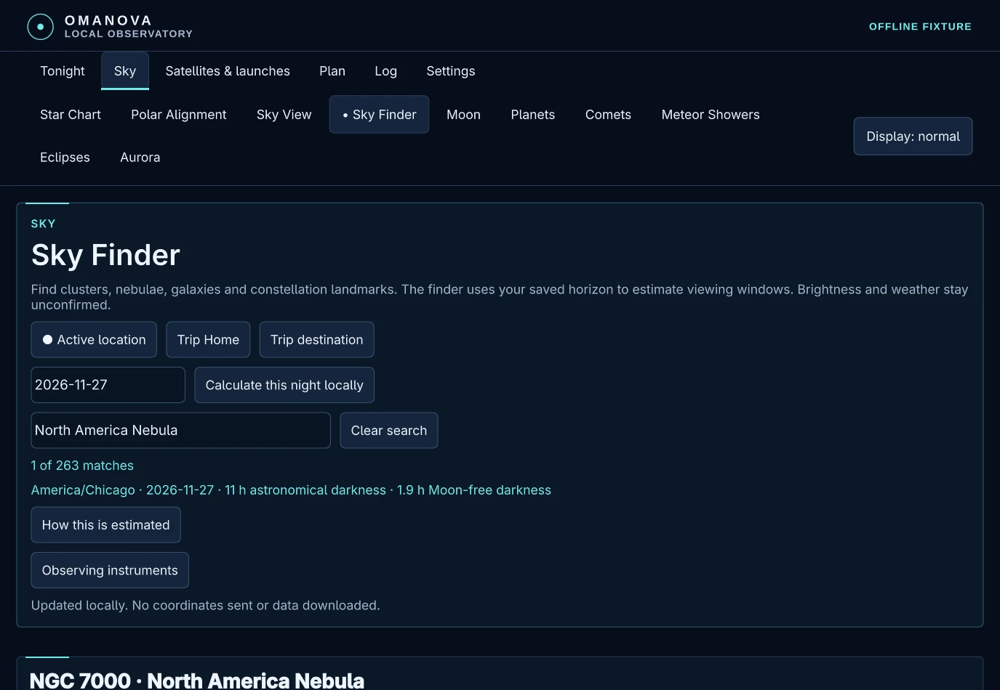
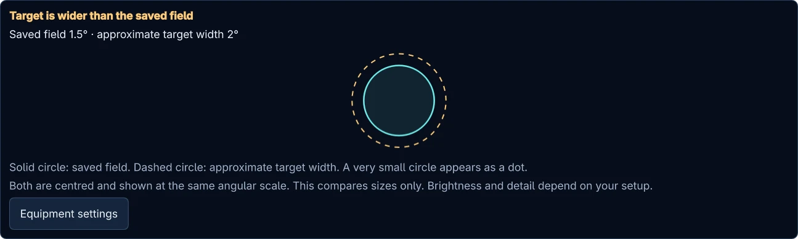

# OMANOVA 0.1.12 screenshots

The Observatory captures use a public Nashville sample location, simulated terrain and weather, and sample NOAA readings.

## My Horizon

## Seeing and transparency

## Solar wind

## Sky Finder

