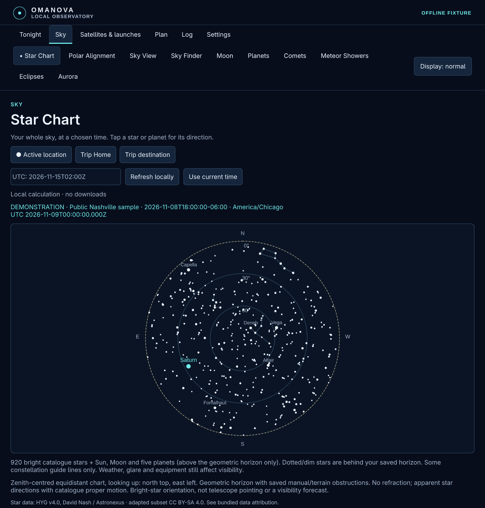
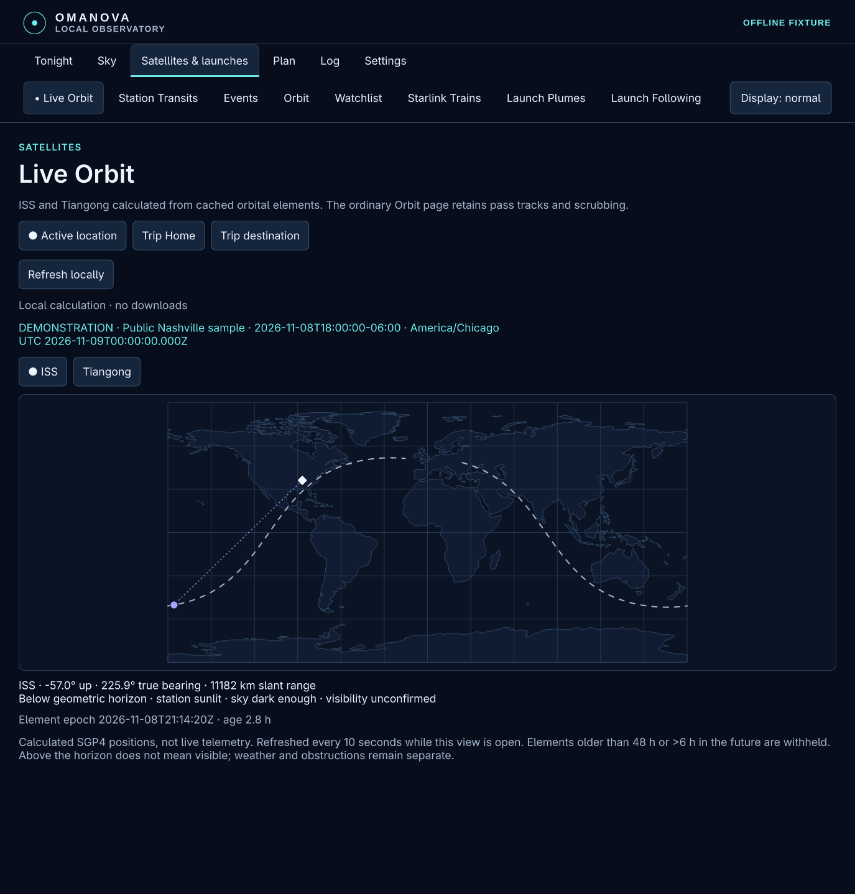
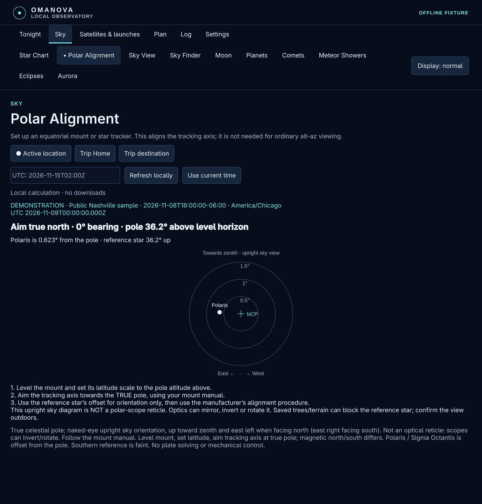
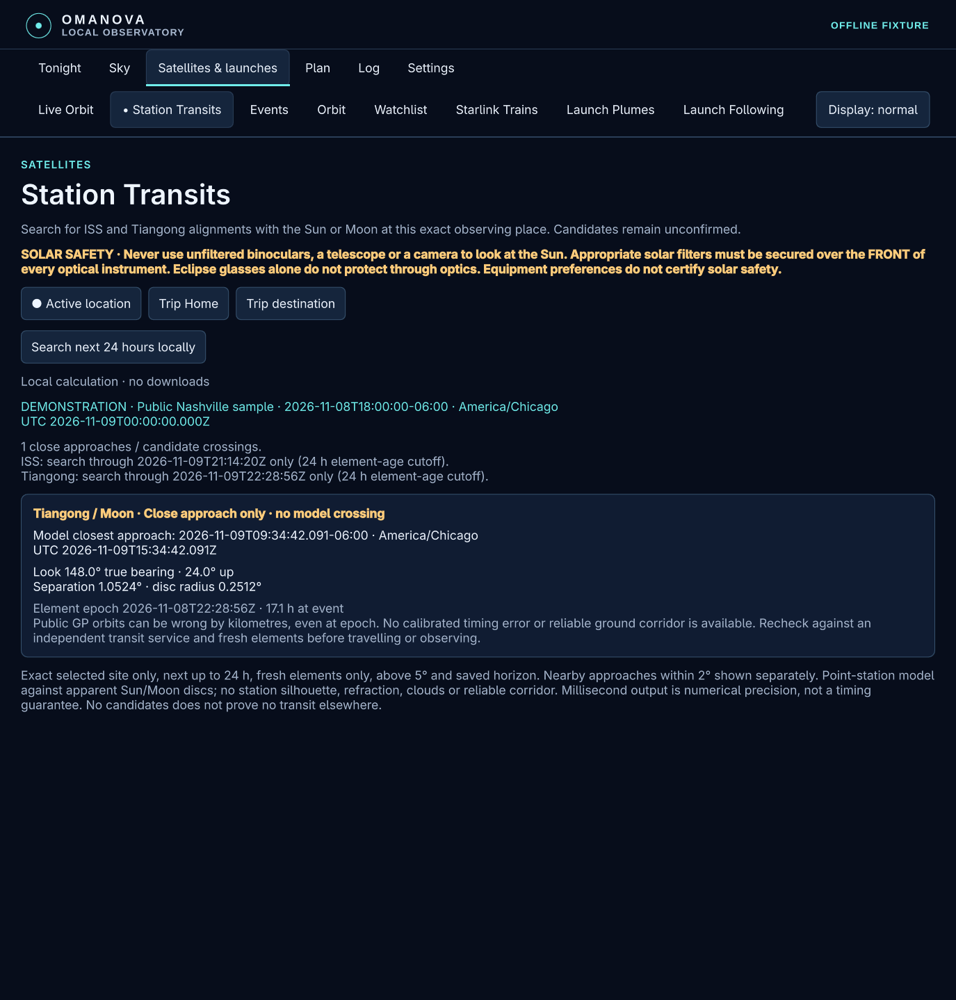
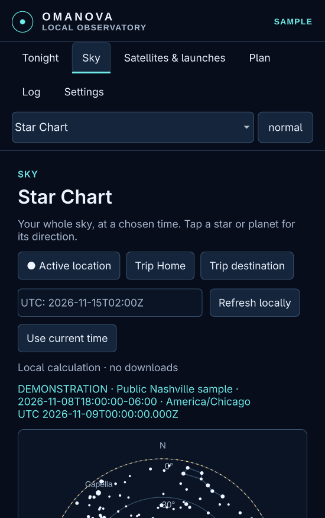
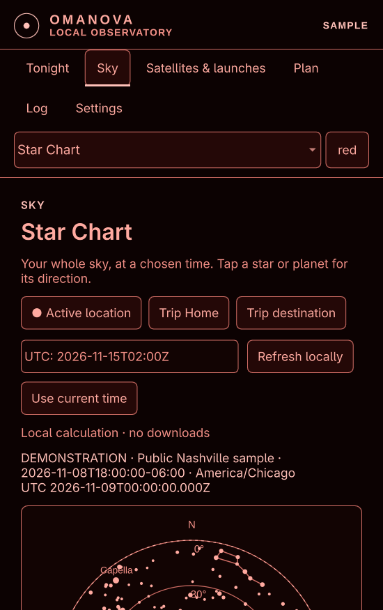
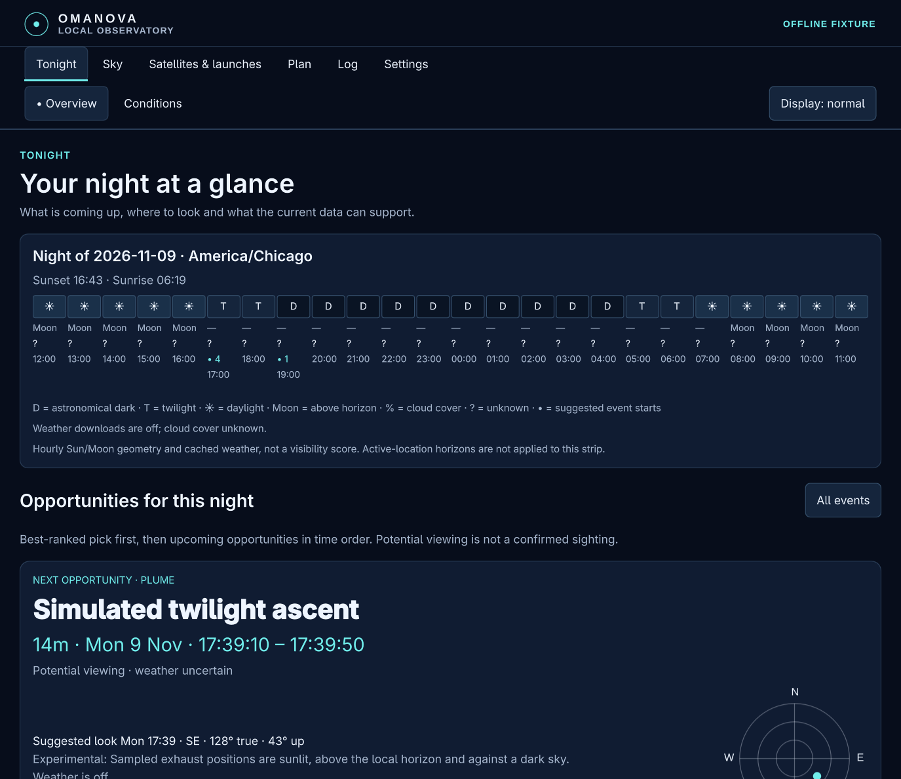
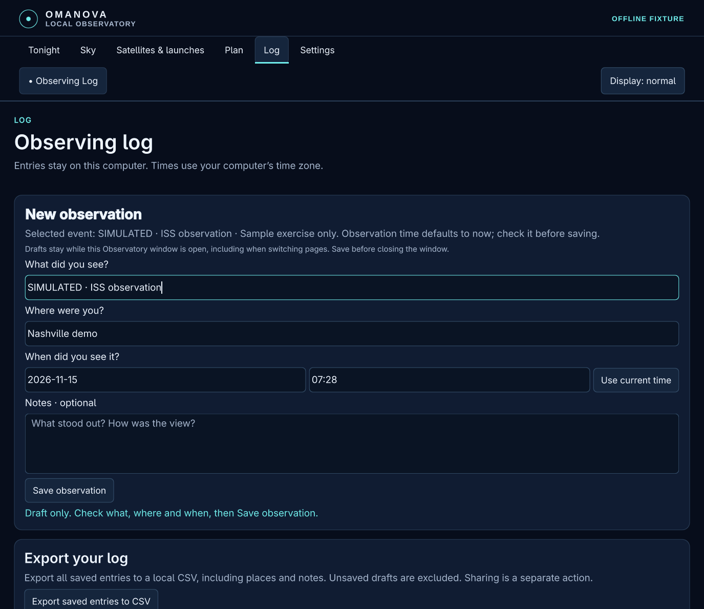
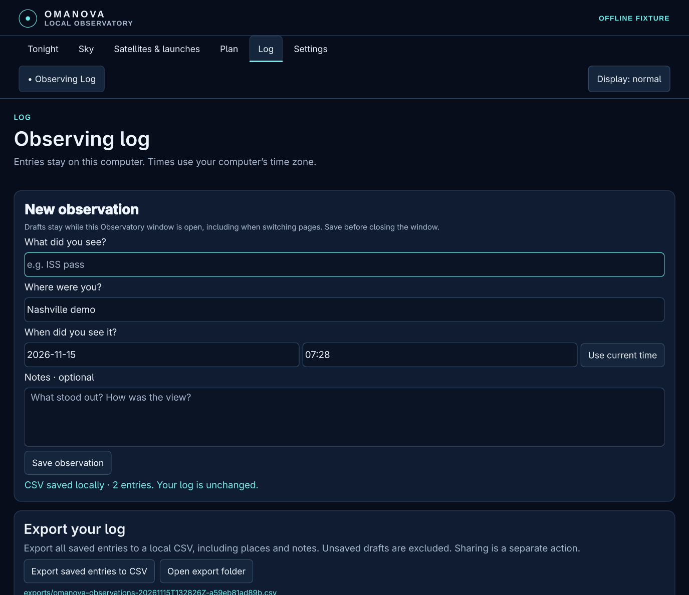
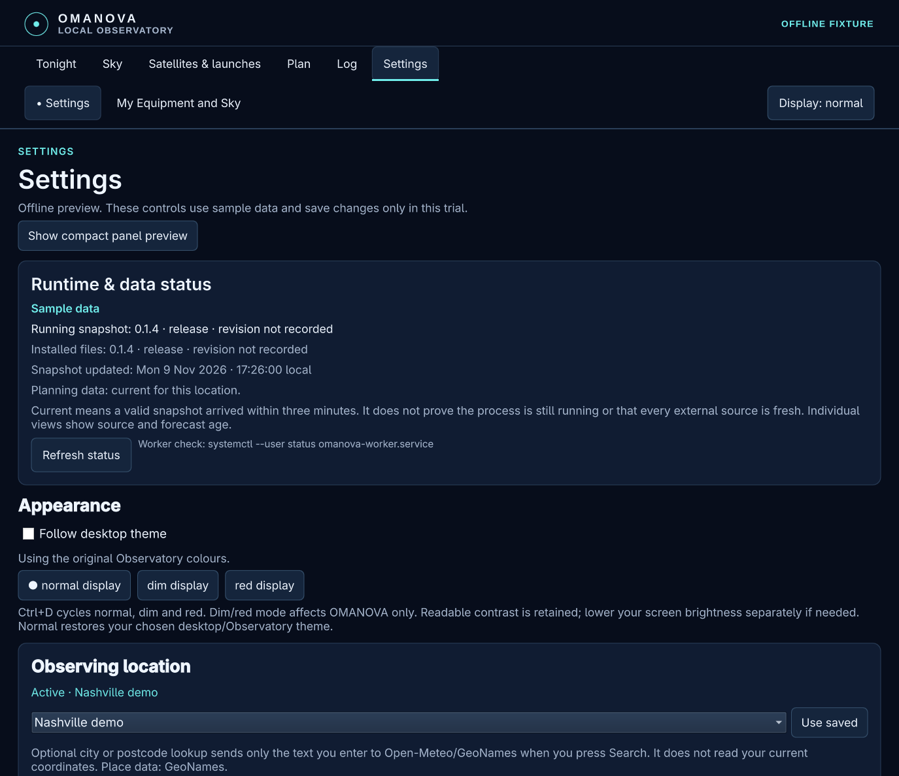

# OMANOVA 0.1.4 — native feature screenshots

Ten actual native-app captures, 15 November 2026, using isolated public
Nashville sample data. These are labelled demonstrations, not current viewing
advice or real observations. The transit example is a lunar close approach,
explicitly **not a crossing**. There are no private home locations, personal
log entries, vault content or unrelated desktop windows in these captures.
The red view changes app colours only; the desktop theme is untouched.

Star data: adapted HYG v4.0, David Nash / Astronexus, CC BY-SA 4.0; see
[attribution and changes](../observatory/final_sky/HYG-LICENSE.md).
Earlier [0.1.3 gallery](SCREENSHOTS-0.1.3.md) and
[original gallery including terrain](SCREENSHOTS.md) remain available.

## Whole-sky star chart

## Calculated current ISS/Tiangong positions

## Polar alignment orientation

## Unconfirmed station alignments and solar safety

## 440 x 700 window navigation

## Readable red observing mode

## Grouped navigation and night overview

## I saw it editable draft

## Local CSV export

## Runtime and planning status

