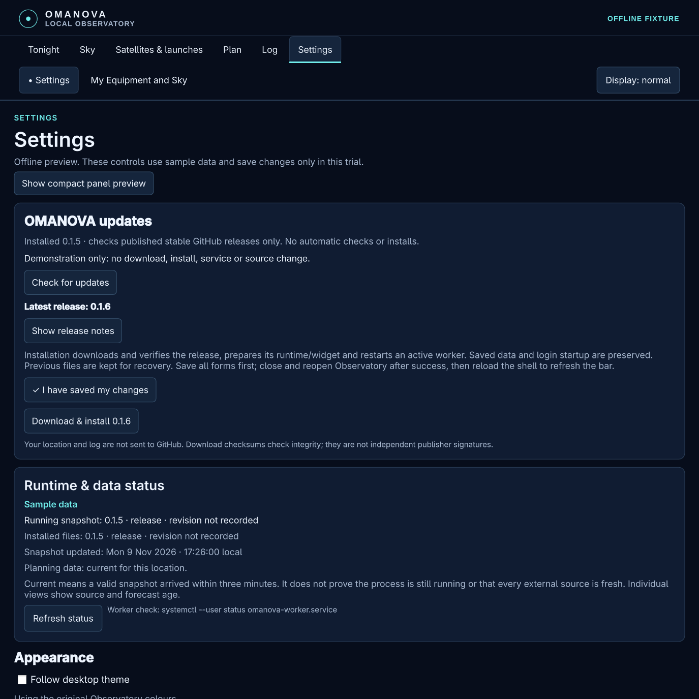
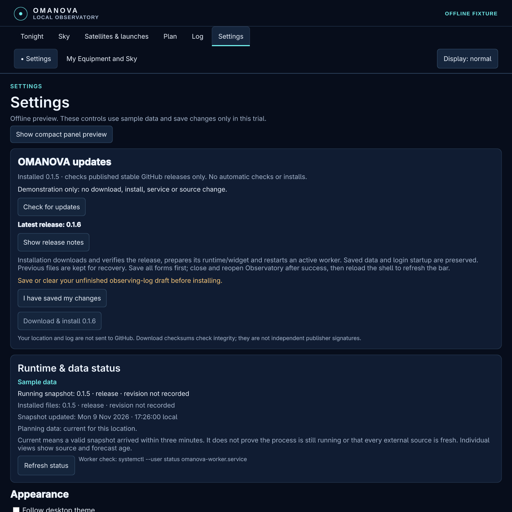
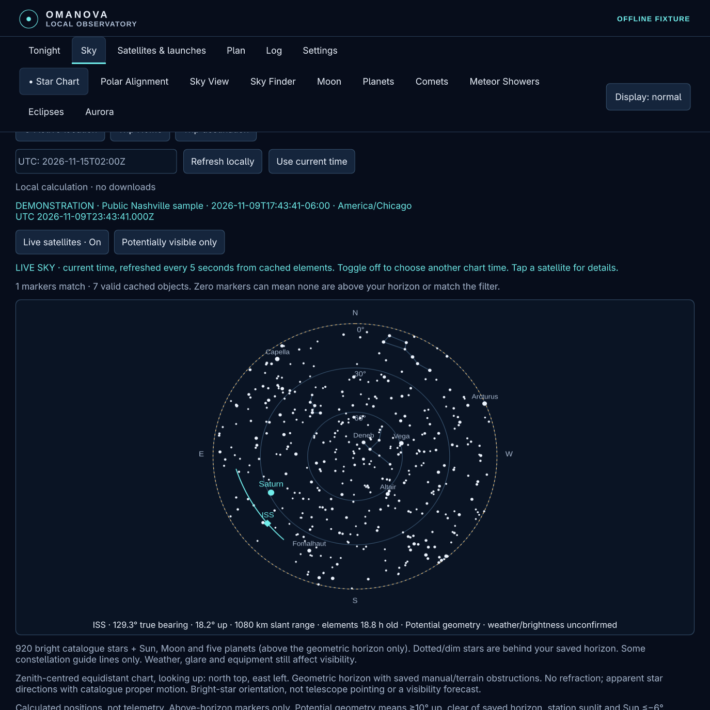
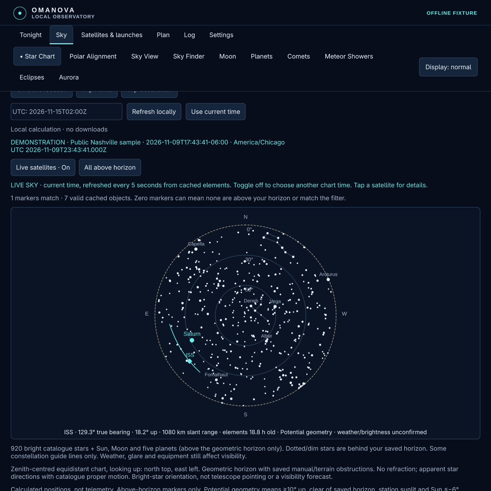
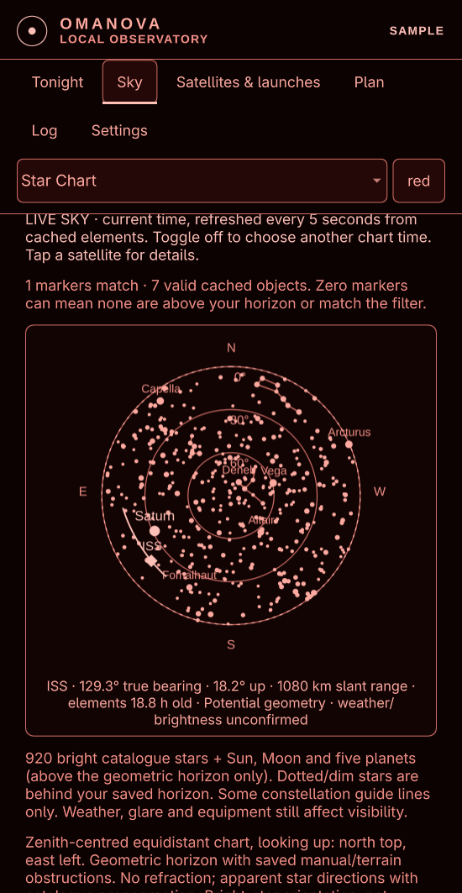
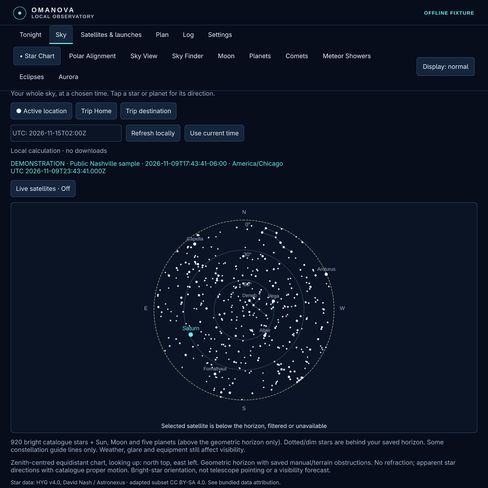

# OMANOVA 0.1.5 — update controls and live sky satellites

Actual native-app captures from an isolated public Nashville sample session,
17 November 2026. No personal locations, log, favourites or other desktop
windows are included. Click an image for full size.

**Updater availability is simulated.** The displayed 0.1.6 is a labelled test
fixture to show the controls, not a published release or actual installation.
The draft guard uses an unsaved synthetic observation; no real log is changed.
Satellite markers are calculated at the displayed demonstration time, not
current observing advice or telemetry. Weather/brightness remain unconfirmed.

Star-chart reference data: adapted HYG v4.0, David Nash / Astronexus,
[CC BY-SA 4.0 attribution](../observatory/final_sky/HYG-LICENSE.md).
The [0.1.4 gallery](SCREENSHOTS-0.1.4.md), [0.1.3 gallery](SCREENSHOTS-0.1.3.md)
and [original gallery, including terrain](SCREENSHOTS.md) remain available.

## Update controls — simulated newer release

## Unsaved log draft blocks installation

## Live satellite layer and selected ISS

## All-above-horizon filter

## Narrow window and red observing mode

## Layer off — static star chart

