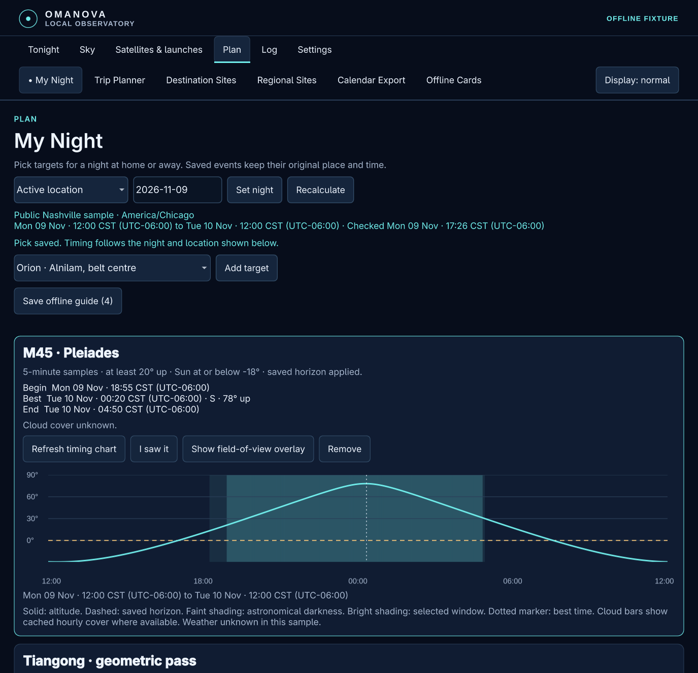
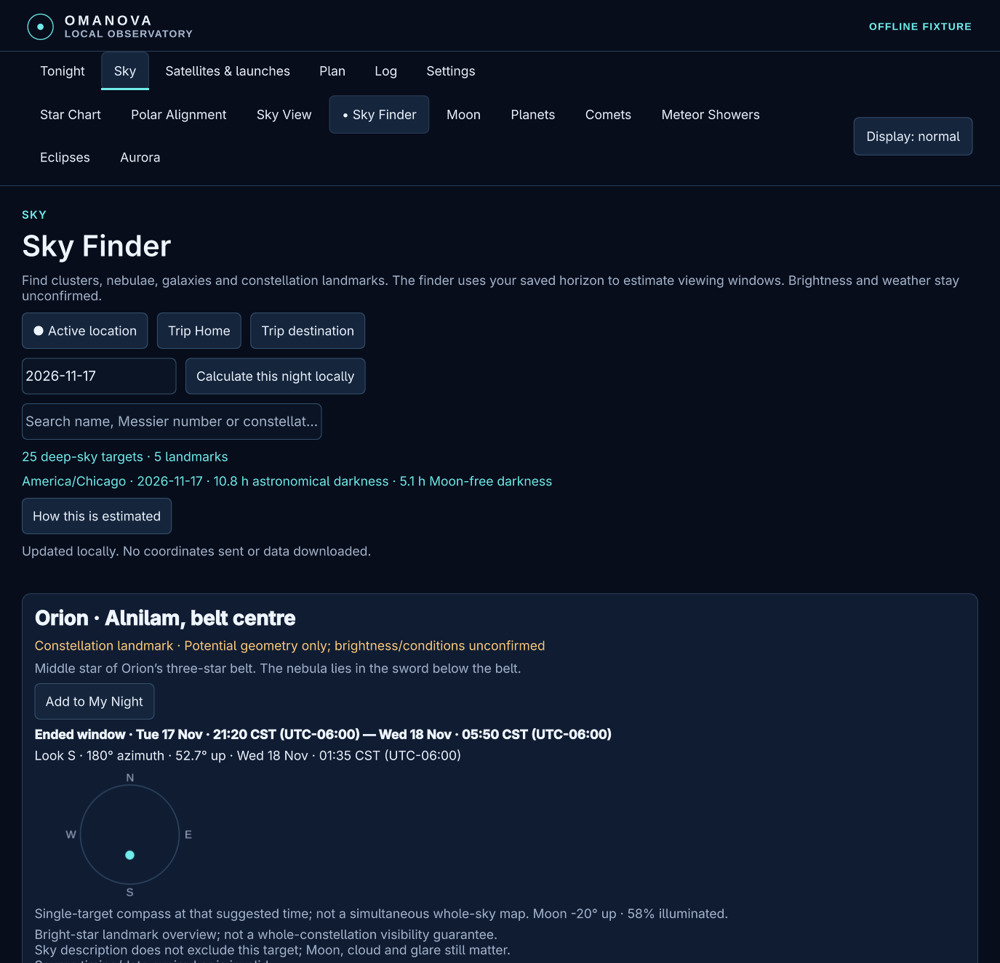
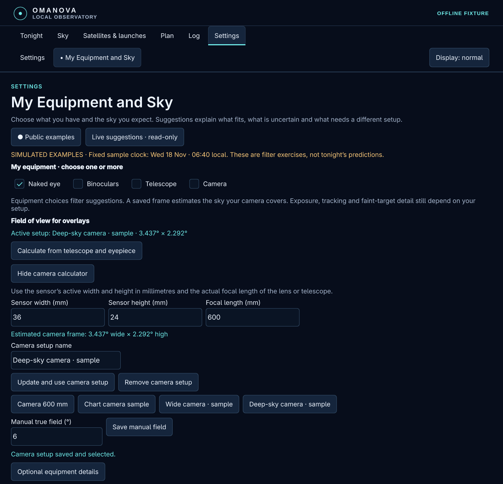
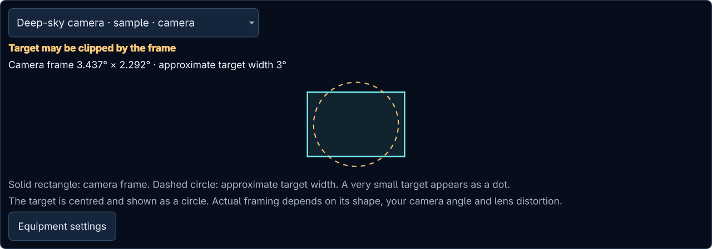
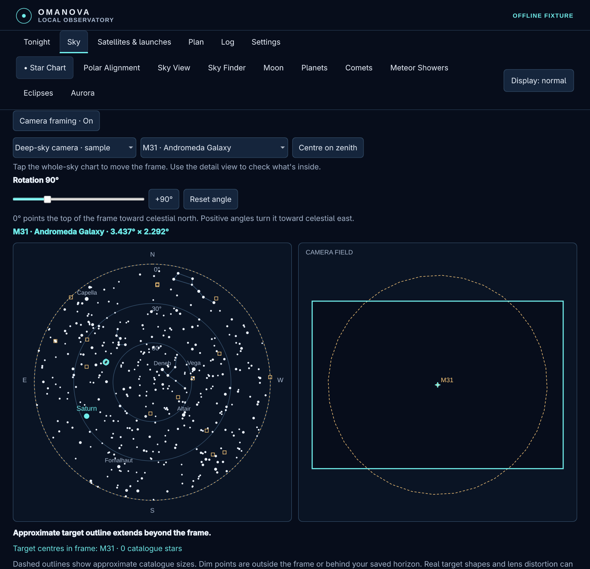

# OMANOVA 0.1.6 screenshots

Native Observatory captures from an isolated public Nashville sample session.
The date, observing picks and optics are fixtures. Click an image for full size.

## My Night and the timing chart

A sample night with selected targets, local viewing times and the Pleiades
timing chart showing elevation against the saved horizon.

## Expanded Sky Finder

The full catalogue of 25 deep-sky targets and five landmarks, with hints and
local viewing windows.

## Camera setup

Enter sensor width, sensor height and actual focal length to calculate and save
a named angular frame.

## Rectangular framing

Sample camera frame compared with Andromeda's approximate catalogue width.

## Rotated camera frame on Star Chart

Whole-sky footprint and camera close-up, with the rectangle turned 90° from
its celestial north reference.

[Previous screenshots](SCREENSHOTS-0.1.5.md) · [Bright-star catalogue attribution](../observatory/final_sky/HYG-LICENSE.md)
