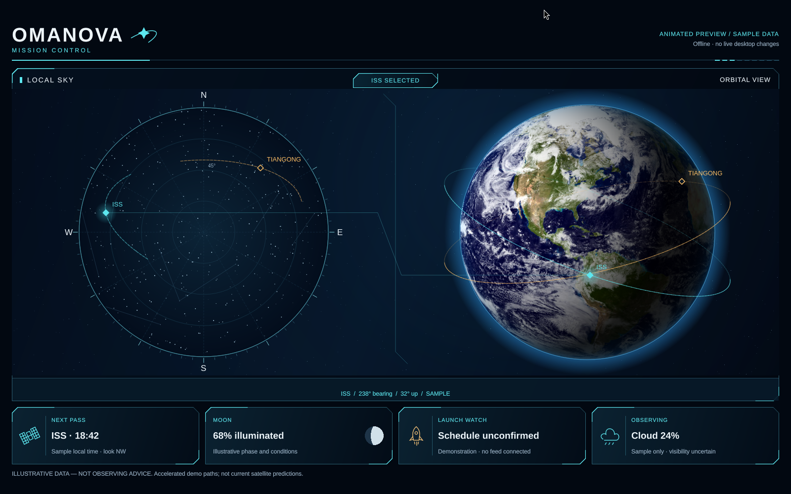
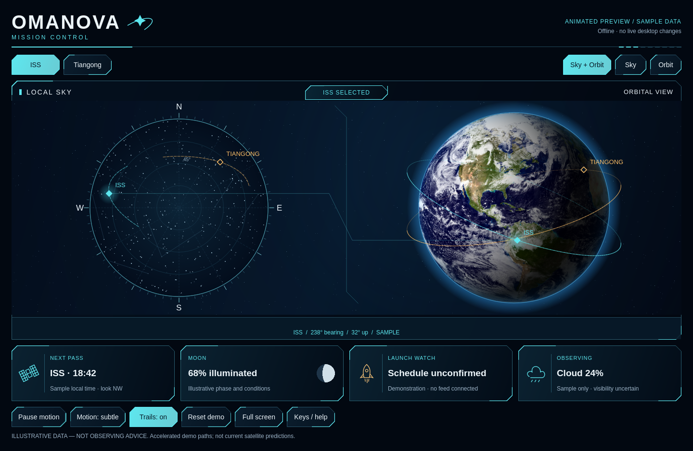
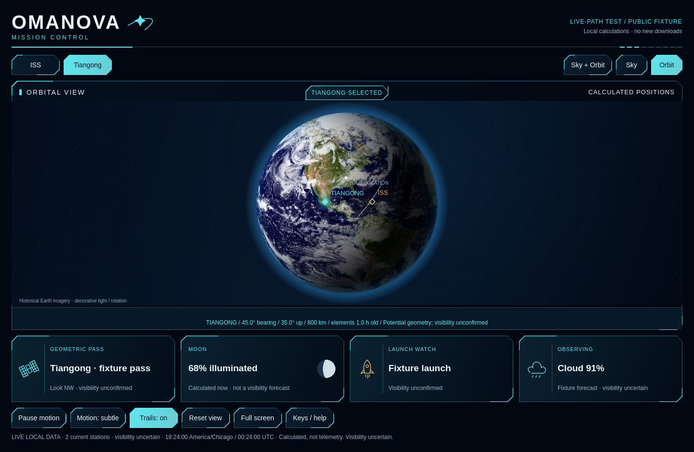
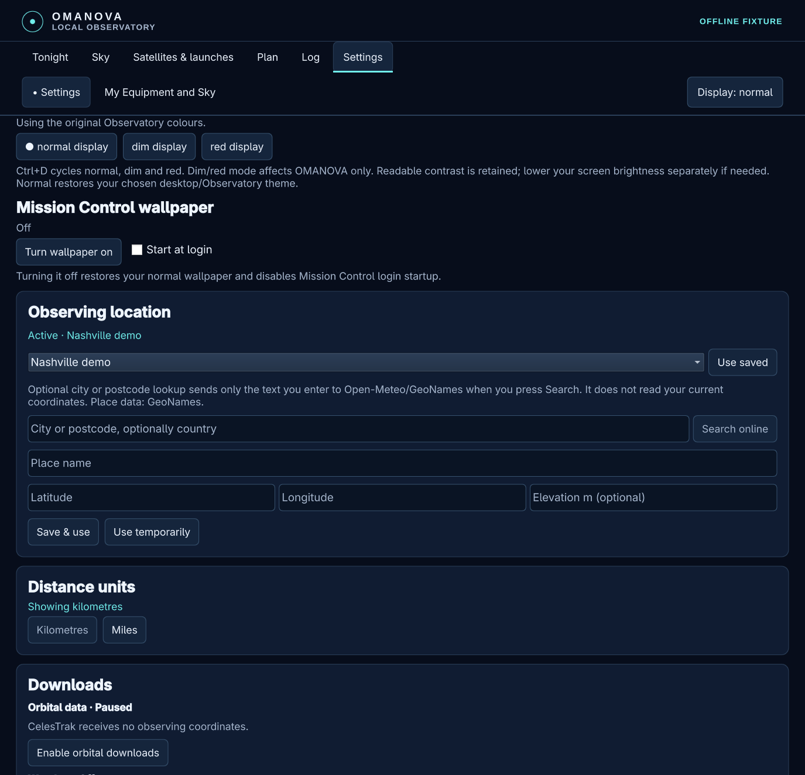

# OMANOVA 0.1.7 screenshots

These captures use sample observing data. They contain no saved locations or personal observations.

## Live wallpaper

Mission Control running as the desktop background on an isolated Hyprland desktop. The separate Restore desktop window was moved to another workspace for the capture.

## Sky and orbit

The Mission Control window offers combined sky and orbit, sky-only and orbit-only views. The first capture shows the combined view. The second shows Tiangong selected in the orbit view, using test data for the live feed.

## Wallpaper settings

Open **Settings → Appearance → Mission Control wallpaper** after setting up the optional component. Both the wallpaper and its login setting are Off on a fresh setup.

[0.1.7 release notes](RELEASE-0.1.7.md) · [Previous screenshots](SCREENSHOTS-0.1.6.md)

Earth imagery: NASA Goddard [Blue Marble](https://science.nasa.gov/earth/earth-observatory/the-blue-marble-true-color-global-imagery-at-1km-resolution/).
