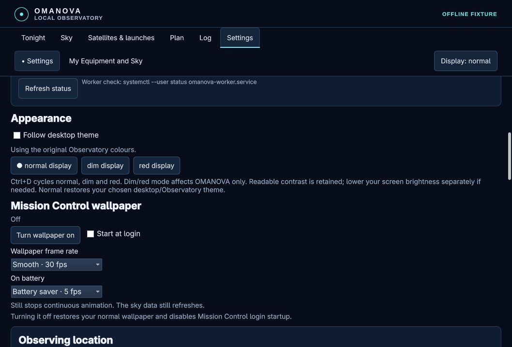
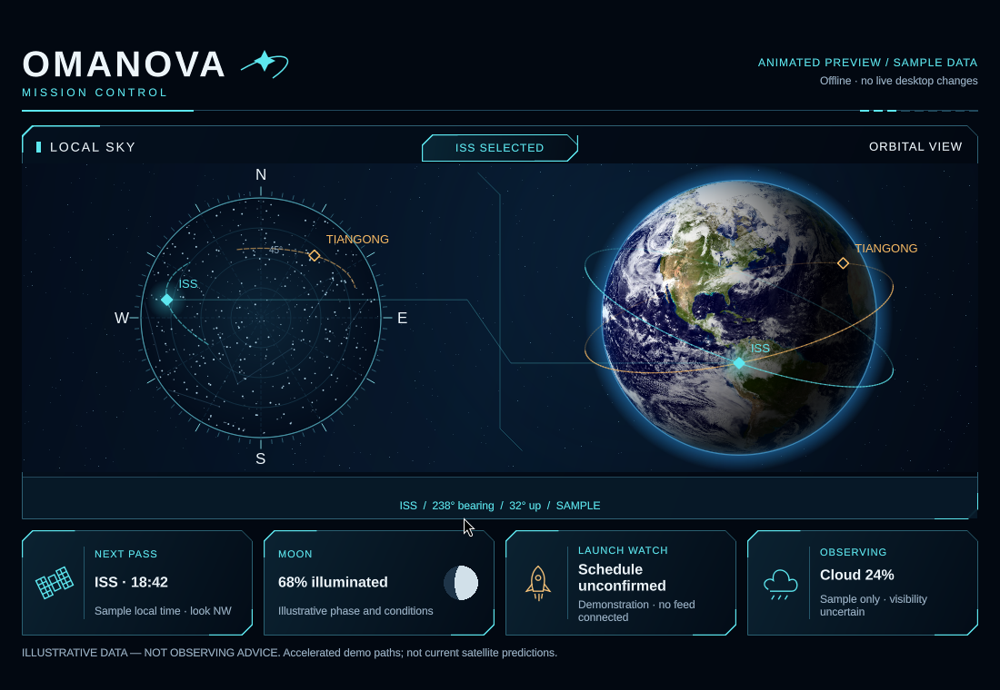

# OMANOVA 0.1.8 screenshots

These are native screenshots from an isolated Omarchy/Hyprland session using sample data.

## Mission Control settings

**Settings → Appearance → Mission Control wallpaper** shows the normal 30 FPS rate and default 5 FPS battery cap. Wallpaper and its login option are both off here. Choose Still to pause continuous animation while sky data refreshes.

## Mission Control wallpaper in Still mode

In Still mode the wallpaper keeps its local sky chart, Earth view and station tracks. This screenshot shows the sample scene on a separate desktop.

[GitHub release](https://github.com/shaggyrs6-netizen/omanova/releases/tag/v0.1.8) · [Full release notes](RELEASE-0.1.8.md) · [Previous screenshots](SCREENSHOTS-0.1.7.md)
