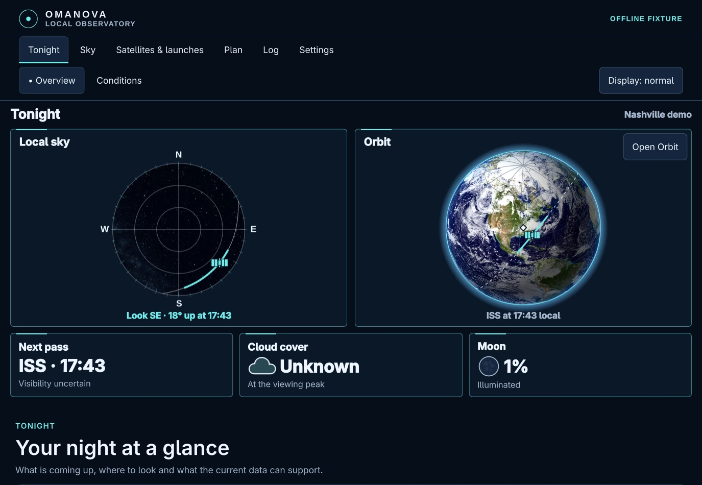
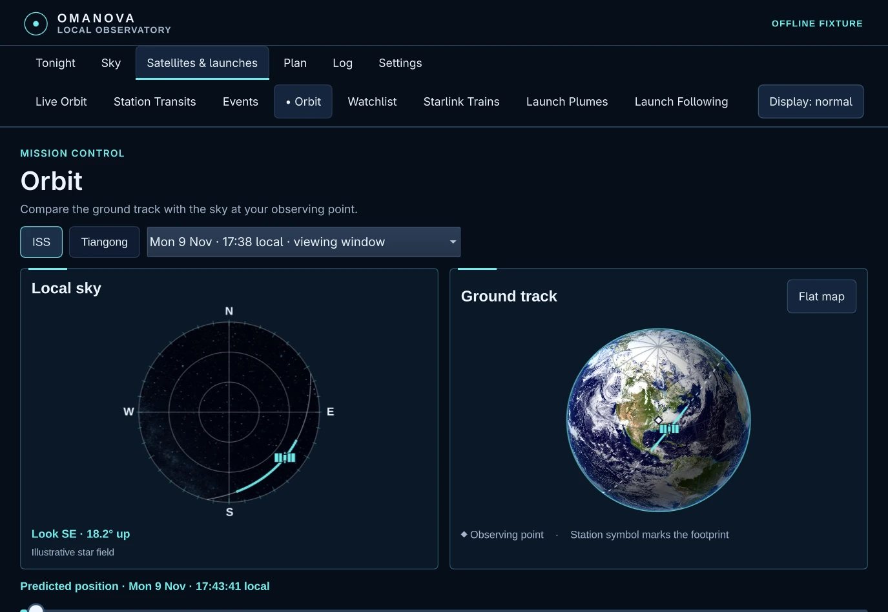
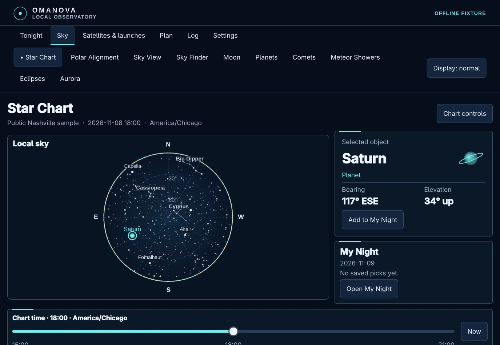
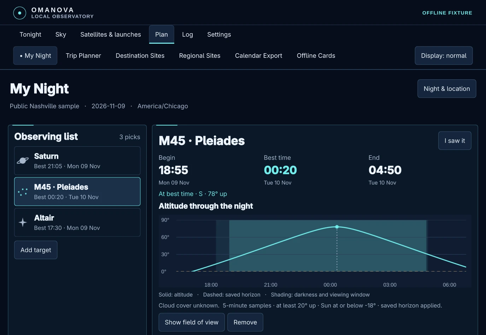
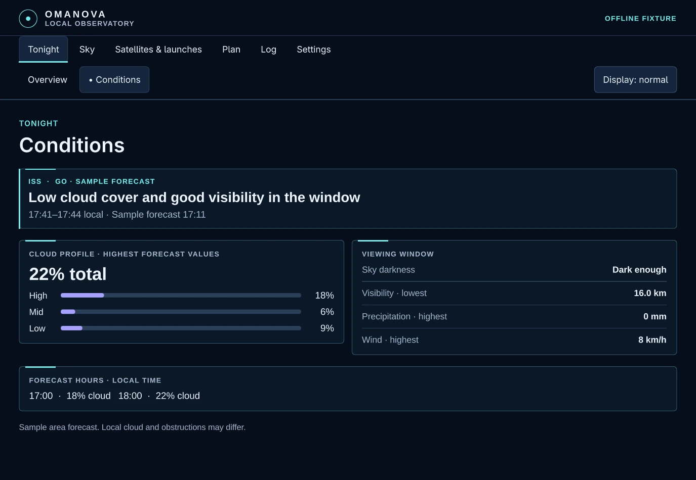
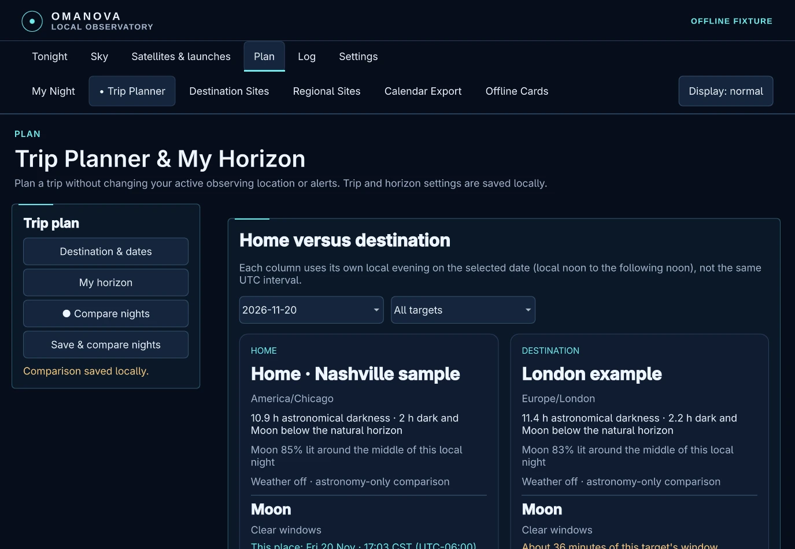
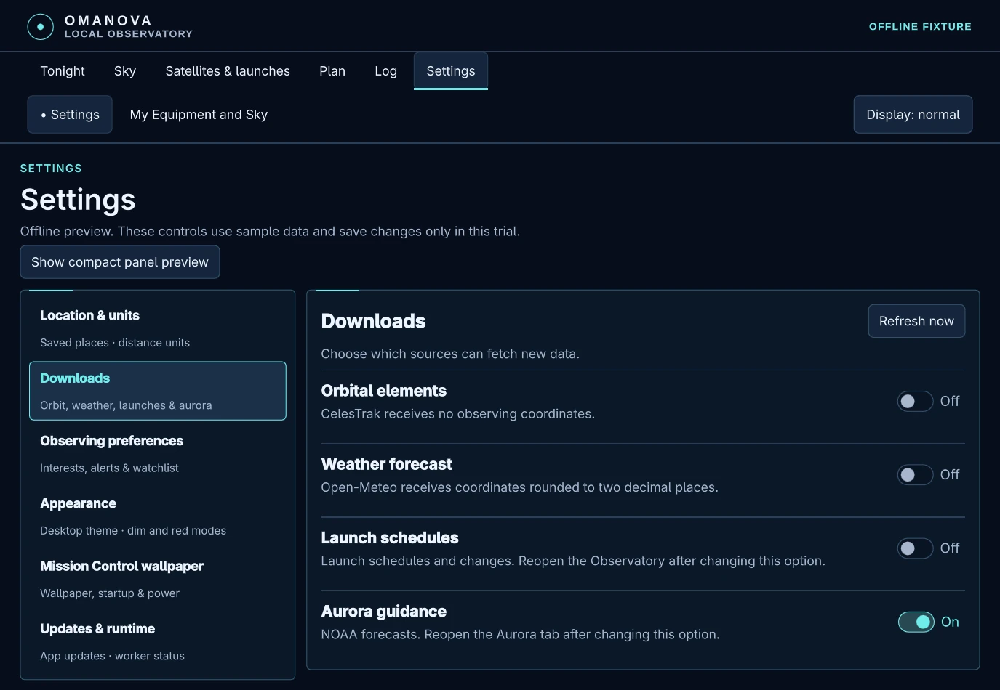
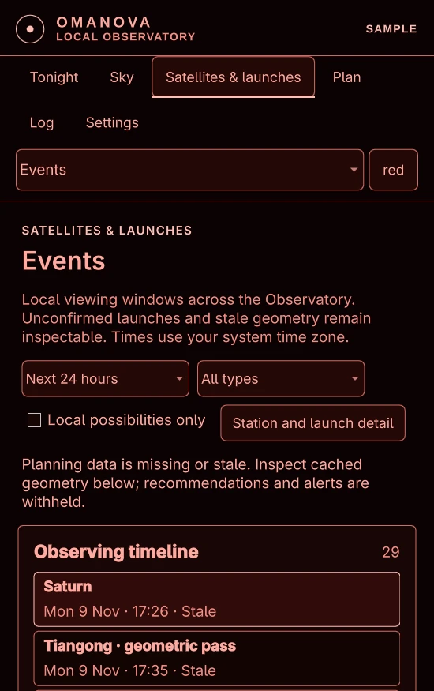

# Observatory screenshot gallery

These native captures use sample observing data. Times, places and weather illustrate the controls.

## Tonight

Local sky, globe and the next observing opportunity.

## Orbit

Station pass geometry and the selected time along its track.

## Star Chart

Selected object details and the shortcut to My Night.

## My Night

The observing list alongside the selected target’s timing chart.

## Conditions

Cloud layers and the forecast for a selected pass.

## Trip Planner

Home and destination observing conditions side by side.

## Settings

Download controls in the reorganised Settings page.

## Events

Events in red observing mode at a narrow window size.

