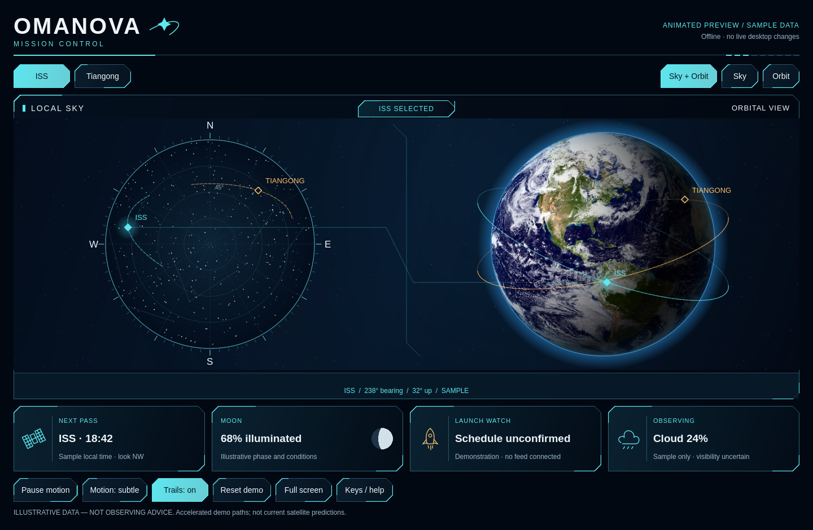

# Mission Control — local animated design preview



A separate native Qt Quick / C++ window exploring the approved OMANOVA Mission
Control concept. **Not a wallpaper installation or OMANOVA release.** Branch:
`codex/mission-control-preview`. No uploads authorised.

## Current live trial

Run `bin/live` for the new read-only connection to installed OMANOVA. Run
`bin/preview` for the original sample-only design. See the live-connection section
below for freshness, privacy and design limits. No app/desktop installation.

## Try it

From this directory run `bin/preview` (builds with qmake6/make if needed).
Close the window to stop it. Nothing is installed, no startup entry or service
is created, and no theme, wallpaper, bar or OMANOVA setting is written.

- Slow, texture-mapped Earth rotation, atmospheric rim and illustrative orbital arcs.
- Illustrative local-sky display with moving ISS/Tiangong markers and trails.
- Choose a satellite with the buttons or its diamond in either view; selection
  highlights the same satellite in both views and changes the sample detail/card.
- Combined, Sky and Orbit views; resizable layout, full-screen preview.
- Pause/resume, reduced motion, trails and reset. Paused/minimised windows stop
  the render timer. Rendering is capped at 20 fps; globe texture updates at 5 fps.
- Native readable navy/cyan controls, keyboard focus outlines, a Moon phase
  illustration, and explicit sample-data warnings. Fixed concept palette in
  this design preview, not a change to the desktop theme.

| Key | Action |
| --- | --- |
| Space | Pause / resume |
| R | Reduced / subtle motion |
| T | Trails on / off |
| 1 / 2 | ISS / Tiangong |
| F11 | Full screen / window |
| Esc | Leave full screen / dismiss help |
| ? | Keyboard help |
| Q | Close preview |

## Data / limits

Entirely offline at runtime: no private locations, saved profiles, observing log,
orbital cache or worker are read. No download, network request or process launch
is made by the application. Qt platform rendering may use normal session/driver
facilities. The build uses only the system's existing Qt/C++ tools.

**All star placements, sky lines, satellite paths, bearing/elevation details,
pass times, phase, cloud and launch cards are design fixtures**, not predictions.
The two map views share selection, not a physically validated common orbit.
Earth rotation, lighting and paths are cinematic/accelerated. No real-world
observing accuracy claim, current launch schedule, telemetry or NASA endorsement.

This step proves motion, composition and interaction. Background-layer placement,
actual sky/SGP4 projection, live-data freshness, true lighting, theme packaging,
multiple monitors and wallpaper performance remain separate future work.
Do not install it as a wallpaper or merge into a release without Lee's approval.

## Build / checks

`bin/build` compiles into ignored `build/`. `bin/check` runs the real native QML
with an offscreen software renderer and writes ignored screenshots/checks under
`evidence/offscreen/`. Checks exercise animation, QML controls, pause/resume,
reset and invalid selection. Inspect screenshots for layout; numerical checks
are not aesthetic approval. Native Wayland captures can be made using the same
binary's `--qa /absolute/evidence-directory` switch; it exits after the checks.
QA does not change global input, desktop settings, files or services.

## Credits

Earth texture: NASA Goddard Space Flight Center, Reto Stöckli and Robert Simmon,
Blue Marble (2002), adapted from MODIS observations and other credited data.
Source article and image credits:
https://science.nasa.gov/earth/earth-observatory/the-blue-marble-true-color-global-imagery-at-1km-resolution/
Bundled unmodified JPEG (2048 × 1024):
https://assets.science.nasa.gov/content/dam/science/esd/eo/content-feature/bluemarble/images/land_ocean_ice_cloud_2048.jpg
This is historical composited imagery, not live cloud imagery. UI applies an
illustrative spherical projection, shading and atmospheric glow locally.
Original preview code is covered by the repository's MIT licence; NASA material
retains its own attribution and usage terms. No NASA logo is used.

## Read-only live connection — local follow-up

Branch `codex/mission-control-live` adds `bin/live` to open a separate window
using the installed OMANOVA runtime and existing active location. `bin/preview`
still opens the offline design demonstration. Nothing is installed into the
OMANOVA release or wallpaper. The original sample screenshot above is retained.

The native app runs `live_bridge.py` with the installed pinned Python interpreter
every five seconds while open/unpaused, with a 12-second timeout and bounded
local response. It never runs the worker, downloads, notifications or settings
commands. Coordinates remain in local files/stdout pipes, never process argv.
`-B` and PYTHONDONTWRITEBYTECODE prevent writes to installed Python source.

Live mode uses the existing HYG apparent-star calculation, current Sun/Moon/
planet directions, manual/terrain horizon, local SGP4 sky directions and genuine
station subpoints/ground tracks (±45 minutes). Sky looks up: **east left**.
Only above-horizon stations have sky markers. The globe hides stations/tracks
on the far hemisphere and marks the observing location. Ground tracks are
projections on Earth, not a claimed perspective-accurate 3D orbit. Decorative
Earth rotation/light and historical NASA cloud imagery are labelled; they are
not a live cloud map or a physically computed solar terminator.

Stars/positions come from local calculations, not telemetry. Frames older than
15 seconds or future-dated are withheld. Missing/error data never falls back to
samples. Element ages must remain between −6 and +48 hours; position failures
are withheld. Pausing withholds live markers, rather than presenting frozen
positions as current. Below-horizon / missing-element states remain explicit.

Cards read the next geometric station pass from a matching active-place snapshot
no more than three minutes old, compute current Moon illumination, and read
existing opted-in weather/launch caches no more than six hours old. Forecast
location keys must match. Future timestamps, demo snapshots and disabled feeds
are withheld. Passes and launches keep visibility unconfirmed. No GO is inferred
from the map. Saved locations, equipment, logs, bar, installer and worker service
are not modified. Local/UTC timestamps and the location time zone are shown.

Star catalogue credit: HYG v4.0, David Nash / Astronexus, CC BY-SA 4.0; see
[the existing attribution](../observatory/final_sky/HYG-LICENSE.md). This preview
reads the installed catalogue; it does not distribute a separate star dataset.

Checks: seven Python bridge tests, including socket-blocked read-only geometry
in an isolated data directory; original sample-motion checks; native live-path
fixtures for stale/future frames and elements, missing data, paused withholding
and below-horizon details. Actual live native acceptance observed two fresh
frames five seconds apart through the production helper. Personal calculation
output/screenshots stay under ignored `evidence/`, not public assets.

**Design direction:** Lee wants the approved concept's richer Mission Control
look to guide a future OMANOVA app redesign as well. The concept is a visual
target, not the final executable interface or a promise of identical output.
This task connects the preview to live data; it does not authorise replacing the
main app, installing a desktop theme/background or publishing a new release.
The original sample-only statements above describe the original `bin/preview`.

## Mission Control visual polish — 17 November 2026

Local branch `codex/mission-control-polish` keeps the live read-only window and
brings the approved concept into the actual interface: angled instrument frames,
restrained cyan edge accents, orbital wordmark, linked selected-object display,
larger map area, custom satellite/launch/weather icons and matching controls.
The connection line only appears when the selected marker is actually drawn
in both maps; it denotes selection, not a communications link. Sky markers,
subpoints, horizon projection and freshness rules retain their existing meaning.

Compact layouts keep readable card values and uncertainty text. Hover a card
for its full value/details when text is elided. The pass card remains explicitly
geometric; no visibility claim is created by the brighter styling. Reduced
motion and keyboard controls are unchanged. Decorative Earth imagery/light
still remains labelled, and no new downloaded assets or animation loops were
added. Original `assets/preview.png` is retained as a historical comparison.

Final sample-control regression, native live-path fixtures and smaller-window
visual checks passed. Actual read-only native check received two fresh frames
five seconds apart and verified pause/resume withholding. Eleven protected
saved/config files matched after opening the new window; the existing worker
PID and active/enabled preference were identical. Installed 0.1.5 managed source
preflight passed. The live bridge and its geometry tests are unchanged.

The polished live window is left open for feedback. This is still a separate
preview, not a main-app redesign or wallpaper installation. No uploads, release
or marketplace changes. Private live evidence remains ignored under `evidence/`;
the reference image above is explicitly offline sample data.

## Temporary live wallpaper trial

Branch `codex/mission-control-wallpaper` adds `bin/wallpaper start`, `stop` and
`status`. This is a **session-only trial**, not a theme installation. It uses
already-installed LayerShellQt alongside Qt; no package is installed by scripts.

```sh
mission-control/bin/wallpaper start
mission-control/bin/wallpaper stop
mission-control/bin/wallpaper status
```

The wallpaper sits on the primary monitor's **bottom layer**, above Omarchy's
unchanged original background and below normal application windows/bar. It
receives neither pointer input nor keyboard focus and reserves no workspace.
The normal preview controls are hidden on the wallpaper. A separate ordinary
control window has satellite/motion controls and a prominent **Restore desktop**
button. Closing that control window or pressing Esc while it is focused also
ends the whole trial. If it is minimised, bring it back through the usual app
switcher. The stop command above is an independent fallback.

Restoration removes only our layer: the original Omarchy background never stops
running, and no theme/background selection is rewritten. If you deliberately
change your normal wallpaper underneath the trial, that newer choice is what
reappears. No shell restart, desktop shortcut, persistent window rule, startup
entry or service is created. The existing OMANOVA worker/autostart choice is
unchanged. Trial autostart is **off**, and the trial ends with the login session.

The wrapper serialises starts and verifies PID + process-start identity,
executable and process group before stopping its own trial. It requires both
its layer and restore-control window before reporting ready, refuses duplicates,
and stops a failed/unconfirmed start. Receipt/logs are local and private under
`$XDG_RUNTIME_DIR/omanova-mission-control-trial/`. No other application is killed.
Monitor disconnect closes the trial safely; multiple-monitor deployment and a
new login-startup feature are not part of this trial.

Validation: sample and live controller-button restoration removed the trial
layer, leaving the original `omarchy-background` running. CLI stop and duplicate
start checked. PID mismatch/recycled-start guards checked with an unrelated
isolated test process. Protocol inspection confirmed bottom-layer placement,
keyboard interactivity zero and an empty input region (the later region adds
in that trace concern opaque rendering, not pointer input). Native proof was
2752×1152 logical pixels, mouse-transparent and fresh live data. Original
wallpaper selection and eleven protected saved/config hashes remained unchanged;
worker PID/active/enabled state and installed 0.1.5 baseline matched. Existing
sample/live freshness regressions passed. Actual live screenshot remains private
under ignored `evidence/`; nothing uploaded or added to OMANOVA's release.
