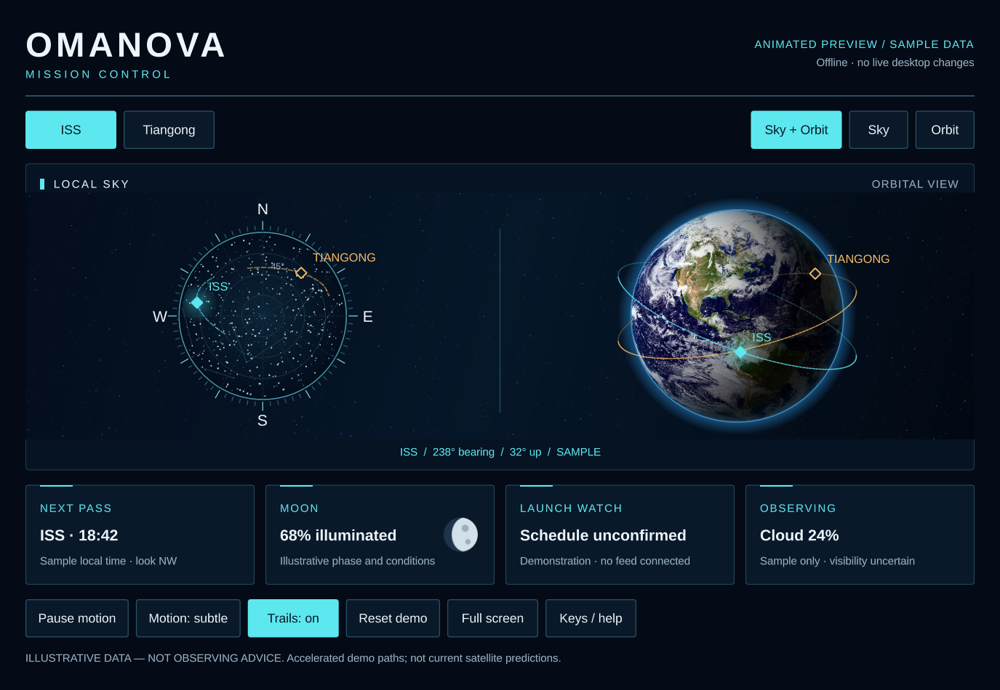

# Mission Control — local animated design preview

A separate native Qt Quick / C++ window exploring the approved OMANOVA Mission
Control concept. **Not a wallpaper installation or OMANOVA release.** Branch:
`codex/mission-control-preview`. No uploads authorised.

## Try it

From this directory run `bin/preview` (builds with qmake6/make if needed).
Close the window to stop it. Nothing is installed, no startup entry or service
is created, and no theme, wallpaper, bar or OMANOVA setting is written.

- Slow, texture-mapped Earth rotation, atmospheric rim and illustrative orbital arcs.
- Illustrative local-sky display with moving ISS/Tiangong markers and trails.
- Choose a satellite with the buttons or its diamond in either view; selection
  highlights the same satellite in both views and changes the sample detail/card.
- Combined, Sky and Orbit views; resizable layout, full-screen preview.
- Pause/resume, reduced motion, trails and reset. Paused/minimised windows stop
  the render timer. Rendering is capped at 20 fps; globe texture updates at 5 fps.
- Native readable navy/cyan controls, keyboard focus outlines, a Moon phase
  illustration, and explicit sample-data warnings. Fixed concept palette in
  this design preview, not a change to the desktop theme.

| Key | Action |
| --- | --- |
| Space | Pause / resume |
| R | Reduced / subtle motion |
| T | Trails on / off |
| 1 / 2 | ISS / Tiangong |
| F11 | Full screen / window |
| Esc | Leave full screen / dismiss help |
| ? | Keyboard help |
| Q | Close preview |

## Data / limits

Entirely offline at runtime: no private locations, saved profiles, observing log,
orbital cache or worker are read. No download, network request or process launch
is made by the application. Qt platform rendering may use normal session/driver
facilities. The build uses only the system's existing Qt/C++ tools.

**All star placements, sky lines, satellite paths, bearing/elevation details,
pass times, phase, cloud and launch cards are design fixtures**, not predictions.
The two map views share selection, not a physically validated common orbit.
Earth rotation, lighting and paths are cinematic/accelerated. No real-world
observing accuracy claim, current launch schedule, telemetry or NASA endorsement.

This step proves motion, composition and interaction. Background-layer placement,
actual sky/SGP4 projection, live-data freshness, true lighting, theme packaging,
multiple monitors and wallpaper performance remain separate future work.
Do not install it as a wallpaper or merge into a release without Lee's approval.

## Build / checks

`bin/build` compiles into ignored `build/`. `bin/check` runs the real native QML
with an offscreen software renderer and writes ignored screenshots/checks under
`evidence/offscreen/`. Checks exercise animation, QML controls, pause/resume,
reset and invalid selection. Inspect screenshots for layout; numerical checks
are not aesthetic approval. Native Wayland captures can be made using the same
binary's `--qa /absolute/evidence-directory` switch; it exits after the checks.
QA does not change global input, desktop settings, files or services.

## Credits

Earth texture: NASA Goddard Space Flight Center, Reto Stöckli and Robert Simmon,
Blue Marble (2002), adapted from MODIS observations and other credited data.
Source article and image credits:
https://science.nasa.gov/earth/earth-observatory/the-blue-marble-true-color-global-imagery-at-1km-resolution/
Bundled unmodified JPEG (2048 × 1024):
https://assets.science.nasa.gov/content/dam/science/esd/eo/content-feature/bluemarble/images/land_ocean_ice_cloud_2048.jpg
This is historical composited imagery, not live cloud imagery. UI applies an
illustrative spherical projection, shading and atmospheric glow locally.
Original preview code is covered by the repository's MIT licence; NASA material
retains its own attribution and usage terms. No NASA logo is used.
